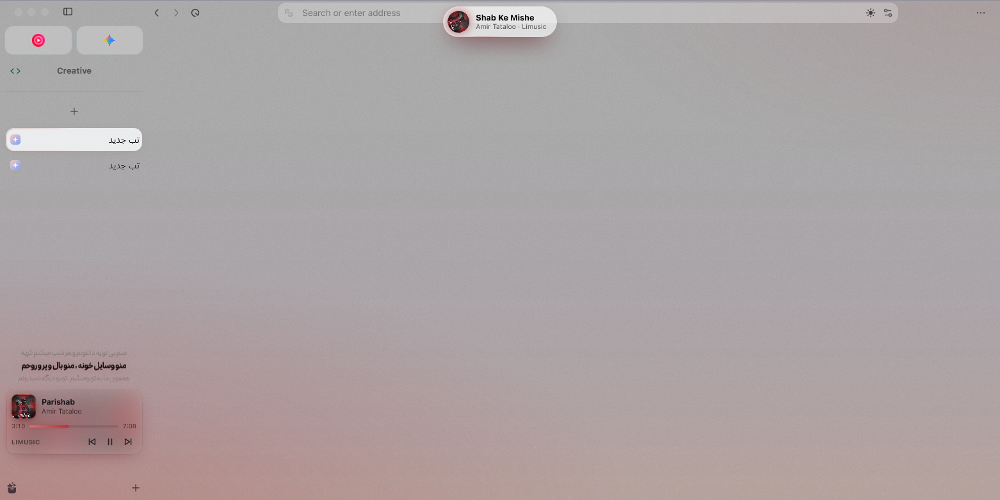
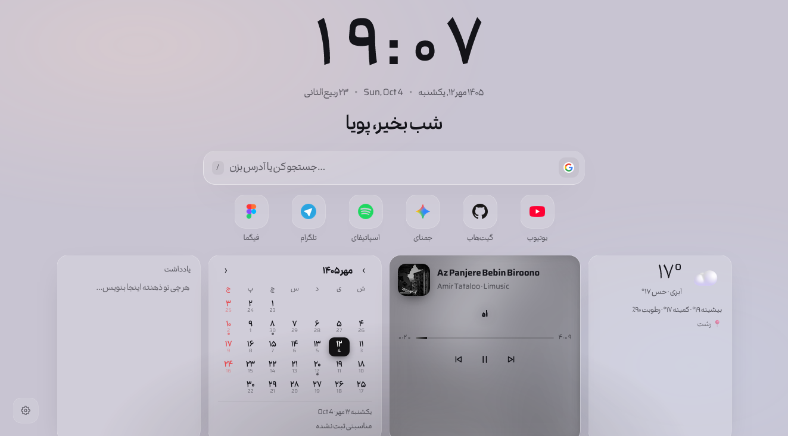
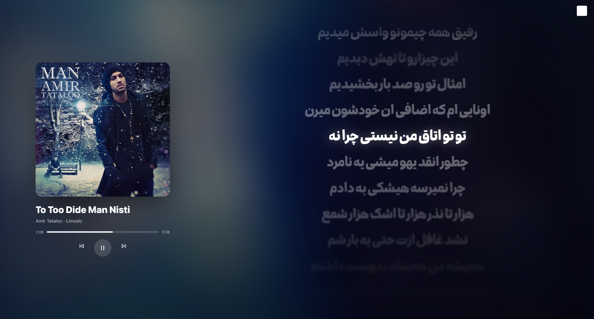
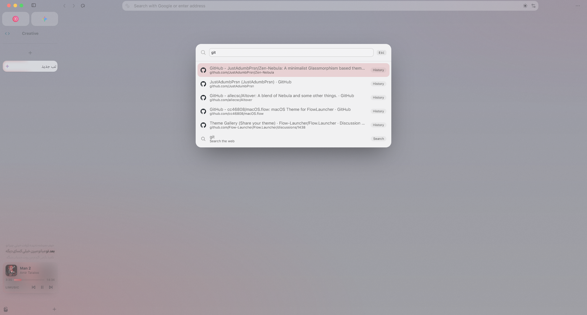
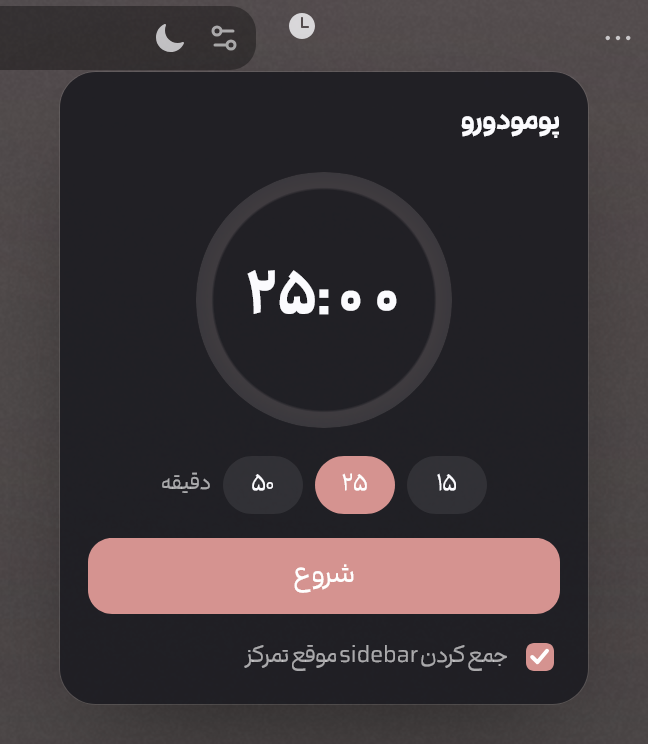
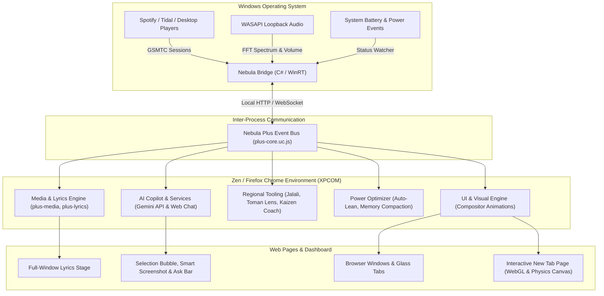

<h1 align="center">✨ Nebula Plus</h1>

<p align="center">
  <strong>An Intelligent, Glassmorphic Productivity & Native Media Suite for Zen Browser (Firefox Engine)</strong>
</p>

<p align="center">
  
  
  
  
  
</p>

---

## 🌌 Overview

**Nebula Plus** is an advanced engineering fork and evolutionary leap of [Zen-Nebula](https://github.com/JustAdumbPrsn/Zen-Nebula). It re-architects the browser from a passive document viewer into an intelligent, hardware-accelerated workstation tailored for modern workflows.

Nebula Plus pairs a deep **Firefox XPCOM/UserChrome runtime** with a dedicated **C# (.NET / Windows SDK) native Windows companion bridge**. It delivers real-time system media tracking, WASAPI loopback audio spectrum analysis, seamless Gemini AI assistance, native Persian & RTL cultural tooling, and a compositor-first UI that runs buttery-smooth on minimal battery and CPU.

---

## 📸 Showcase

<div align="center">
  
  <p><em>Modern glassmorphic browser chrome with traveling comet glows and integrated media controls</em></p>
</div>

<br/>

<div align="center">
  
  
</div>
<div align="center">
  
  
</div>

---

## 🏛️ System Architecture

Nebula Plus bridges the gap between web content, browser chrome internals, and low-level Windows APIs:



---

## ⚡ Core Features

### 🎵 1. Unified Media Hub & Native C# Bridge
* **Native Windows Companion Service (`bridge/`)**: High-performance C# companion application utilizing `Windows.Media.Control` (WinRT) to read global media transport sessions (Spotify, Tidal, web players, YouTube) with zero latency.
* **Live Audio Spectrum Analyzer (`Spectrum.cs`)**: Captures master audio via WASAPI Loopback, computes 16-band real-time FFT spectrum data with logarithmic frequency binning, and feeds fluid equalizer bars in the browser UI.
* **Time-Synced Dynamic Lyrics**: Instant lyrics retrieval from [LRCLIB](https://lrclib.net) with millisecond-precision karaoke fill, depth-of-field blurring for upcoming lines, and native bidirectional (LTR/RTL) rendering.
* **Full-Window Lyrics Stage (`Ctrl+Alt+M`)**: Drifting blurred album background, large synced lyrics in the Meem typeface, interactive seek-to-line, and vinyl record rotation physics.
* **Ambilight & Dynamic Theming**: Ambient album-colored glow spills softly onto browser borders, with automatic brightness/saturation adaptation and gradual fade on pause.

---

### 🤖 2. Multimodal AI Copilot (Powered by Google Gemini)
* **Voice Typing (`Ctrl+Alt+J`)**: Speech-to-text with contextual punctuation and accurate Persian/English transcription directly into any text field.
* **Smart Screenshot (`Ctrl+Alt+S`)**: Crop any screen region for instant OCR, multi-language translation, code extraction, or AI explanation.
* **Contextual Assistant (`Ctrl+Alt+A`)**: Instant summarization, key takeaway extraction, and multi-turn conversations grounded in the current page context.
* **AI Tab Galaxy & Auto-Grouping**: Context-aware tab grouping that clusters open research tabs into logical folders based on page content semantics.
* **AI Page Remix (`Ctrl+Alt+R`)**: Live generative restyling of websites via natural language prompt (custom CSS injection with instant undo and refinement).

---

### 🇮🇷 3. Native Persian & Cultural Productivity Suite
* **Native Jalali (Solar Hijri) Engine**: Accurate Persian dates throughout the sidebar, status island, and new tab dashboard.
* **Live Toman Currency Lens**: Real-time conversion of USD, EUR, and GBP prices on foreign shopping websites into Toman, powered by live Nobitex rates.
* **Keyboard Mistype Fixer (`Ctrl+Alt+Space`)**: Automatically detects and corrects Persian-English layout mismatches on selected text or input fields.
* **Kaizen Spelling Coach (`Ctrl+Alt+Q`)**: Intelligent typo correction that distinguishes between typos and deliberate slang, with an integrated spaced repetition flashcard review system.
* **Persian Typography (Meem)**: Embedded typography engineered for readability across tab labels, panels, URL bar, and lyrics.
* **Hafez Divination (فال حافظ)**: Daily fortune poetry retrieved directly from Ganjoor.

---

### 🎨 4. Compositor-First Visuals & Glassmorphism
* **Zero-Thrash Motion Architecture**: Glows, comets, and light sweeps use compositor-accelerated CSS properties (`transform`, `opacity`, `filter`), avoiding browser layout recalculations and repaints.
* **Intelligent Force Dark Mode (`Ctrl+Alt+D`)**: Single-click dark mode that preserves image and video color fidelity, automatically detects natively dark websites, and supports domain-level whitelisting.
* **Live Weather Simulation**: Real-time Open-Meteo weather integration driving custom procedural rain, snow, and sunlight particle effects rendered on GPU canvases.

---

### 🔋 5. Power & Memory Engineering
* **Auto-Lean Energy Throttle (`plus-autolean.uc.js`)**: Automatically detects battery status and high CPU loads via the bridge; drops background canvas frame rates from 60 FPS to 24 FPS or full suspension.
* **Hardware Decoding Enforcement**: Prioritizes hardware-accelerated H.264 video decoding over software-intensive AV1/VP9 codecs.
* **Active Memory Compaction**: Cleans up idle hidden tabs, releases cached textures, and shuts down dormant background observers when the browser is unfocused.

---

## ⌨️ Shortcuts Reference

| Shortcut | Feature | Description |
| :--- | :--- | :--- |
| `Ctrl+Alt+Space` | **Media Play / Pause** | Toggle playback on active system media session |
| `Ctrl+Alt+←` / `→` | **Previous / Next Track** | Skip tracks globally across all apps |
| `Ctrl+Alt+M` | **Lyrics Stage** | Toggle full-window synced lyrics experience |
| `Ctrl+Alt+L` | **Lyrics Panel** | Toggle compact lyrics under sidebar player |
| `Ctrl+Alt+D` | **Force Dark Mode** | Toggle intelligent smart dark mode on current page |
| `Ctrl+Alt+A` | **AI Assistant** | Open Gemini AI sidebar for page analysis |
| `Ctrl+Alt+J` | **Voice Typing** | Start real-time speech transcription |
| `Ctrl+Alt+T` | **To-Do Panel** | Open natural-language quick-add task list |
| `Ctrl+Alt+B` | **Sticky Notes** | View and create text-anchored page notes |
| `Ctrl+Alt+Q` | **Kaizen Coach** | Open vocabulary and spelling flashcards |
| `Ctrl+Alt+P` | **Wormhole** | Send current link/selection to mobile |

---

## 🛠️ Tech Stack & Implementation Details

| Layer | Technologies |
| :--- | :--- |
| **Browser Runtime** | Firefox Gecko / Zen Engine, XPCOM, UserChrome (`*.uc.js`), WebExtensions IPC |
| **Styling & Shaders** | Modern CSS3 (Variables, Custom Properties, `@container`, Compositor Layers), WebGL, HTML5 Canvas 2D |
| **Native Bridge** | C# 12, .NET (Windows SDK), WinRT (Windows.Media.Control GSMTC), NAudio (WASAPI Loopback Capture) |
| **AI & APIs** | Google Gemini API (Flash/Pro), LRCLIB API, Open-Meteo, Nobitex API, Ganjoor API |
| **Development** | Bun, Prettier, Stylelint, PowerShell Automation |

---

## 🚀 Installation & Development

### Prerequisites
* [Zen Browser](https://zen-browser.app/) installed.
* [.NET 8.0 Runtime or SDK](https://dotnet.microsoft.com/download/dotnet/8.0) (for compiling or running `bridge/`).

### Quick Setup (Development Link)
1. Clone the repository:
   ```bash
   git clone https://github.com/pouya-wp/Nebula-Plus.git
   cd Nebula-Plus
   ```

2. Link into your active Zen profile:
   ```powershell
   powershell -ExecutionPolicy Bypass -File scripts/install-dev.ps1
   ```
   *This automatically creates a directory junction in your Zen profile's `sine-mods/Nebula` directory, registers the modules, and initializes the companion bridge.*

3. To build the C# Bridge from source (optional):
   ```bash
   dotnet publish bridge -c Release -o bridge-dist
   ```

---

## 📄 License & Attribution

* Nebula Plus is licensed under the **GNU General Public License v3.0 (GPL-3.0)**.
* Built upon the foundational aesthetics of [Zen-Nebula](https://github.com/JustAdumbPrsn/Zen-Nebula) by JustAdumbPrsn.
* Developed and engineered by **Pouya ([@pouya-wp](https://github.com/pouya-wp))**.
